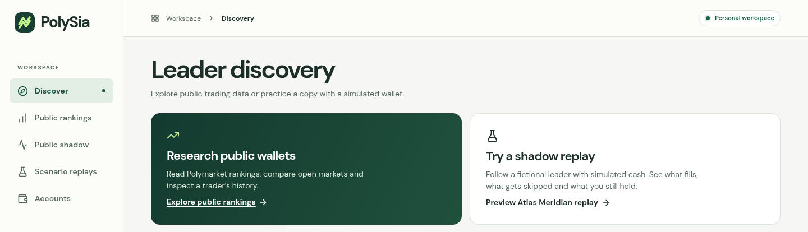

# PolySia

Follow a public Polymarket wallet with simulated cash. See which orders your budget could cover, what you would still hold, and why a trade was skipped. You can also practice offline with a fictional trader. PolySia runs on your Linux machine. It never asks for a wallet key or places a real order.

[Install](#install-on-linux) · [Try a replay](#try-your-first-replay) · [Updates and help](#updates-and-help)

## Install on Linux

You need a single-user Linux machine with Python 3.12 or newer, SQLite support in Python, and `sha256sum`. Use your existing GitHub access to [download polysia.pyz](https://github.com/PolySia-Systems/PolySia/releases/download/v0.5.0/polysia.pyz). You can transfer this file to an offline machine. Only the download needs GitHub access.

Save `polysia.pyz` in a folder only you can change. Open a terminal in that folder. Copy and run both lines together to check the file and start PolySia.

```sh
printf '%s  polysia.pyz\n' 77c6d9873cefdaa8583e3db5d0ab7c088130073171127d7b45ca81a2002c0bea | sha256sum -c - &&
  python3 -I ./polysia.pyz --start
```

Look for **polysia.pyz: OK**, then open the local address printed in the terminal. Keep the terminal open while you use the app. Ctrl-C stops the server. Your saved runs stay on disk. To reopen it, run `"$HOME/.local/share/polysia/current/polysia"`.

## Try your first replay

1. In **Discover**, choose **Try a shadow replay**, then **Start shadow**. Keep the default budget for this example.
2. Select **Observe next signal** twice. The first fictional purchase fills. The second fills only partly. Look at the share count after each purchase.
3. Choose **Stop run**. You can still see the shares you hold. To revisit the result later, open **Scenario replays**.



To try a public wallet, open **Public rankings**, choose a trader, then **Set up public shadow run**. This needs internet access. If a window has no eligible order or a price is missing, inspect the reason in the decision history. Watching an address gives read-only access to public data.

## Updates and help

- **Updating an existing installation?** Back up the workspace and stop the old process before installing the new bundle. The guide includes the backup, restore and rollback commands. [Update and recovery](docs/operations.md#update-and-recover)
- **Download missing or denied?** Sign in to GitHub with the account that can read this private repository and open the [release page](https://github.com/PolySia-Systems/PolySia/releases/latest).
- **Checksum failed?** Stop there. Download a fresh copy from the linked release and repeat the check. If it still fails, report it.
- **Local port busy?** Close the other instance, or add `--port 0` after `--start` in the verified command to print a free local address.
- **Need help?** Include the step, the exact error, your Linux and Python versions, and the build shown in **System status** if the app opens. Leave out tokens, email addresses and workspace data. [Private issue tracker](https://github.com/PolySia-Systems/PolySia/issues)

## Project and evidence

[Operations and developer commands](docs/operations.md) · [Verified provider behavior](docs/provider.md) · [Master Plan](docs/MASTER_PLAN.md) · [Contribution instructions](AGENTS.md)

**Next evidence gate.** Observe a first-time owner starting from this page without coaching. Can they install, explain a skipped entry, stop a run and find the remaining shares after restart? Record completion and any help needed in the task or PR.
